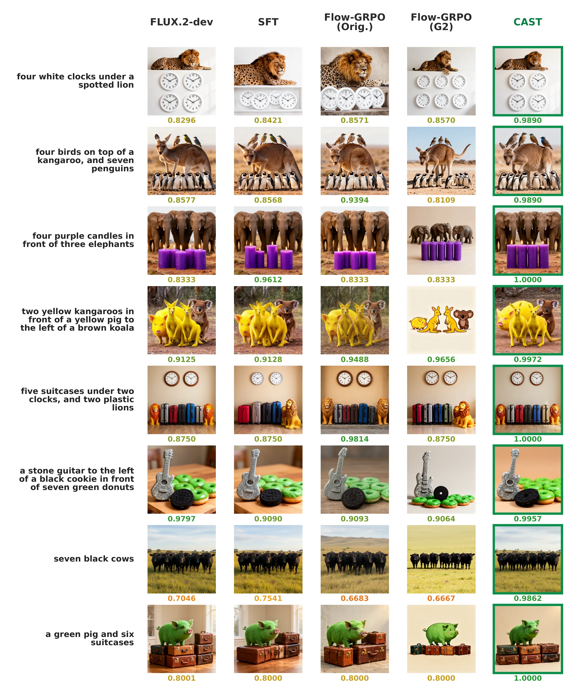
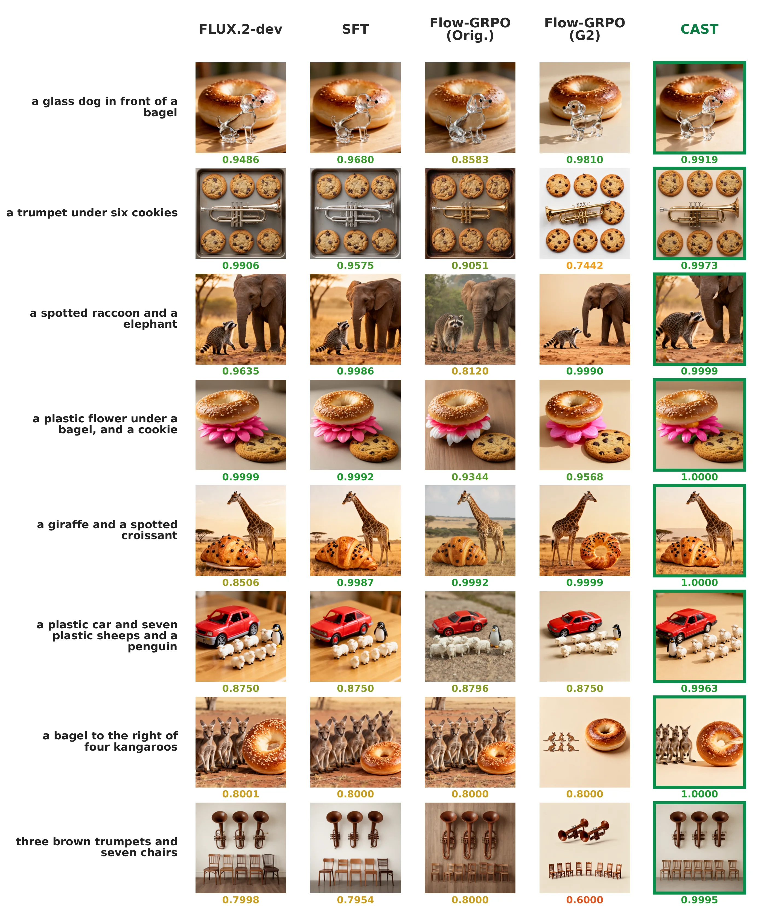
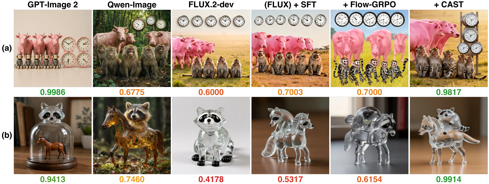
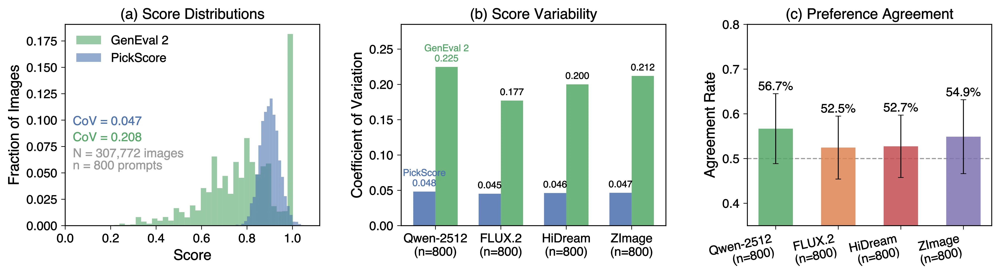
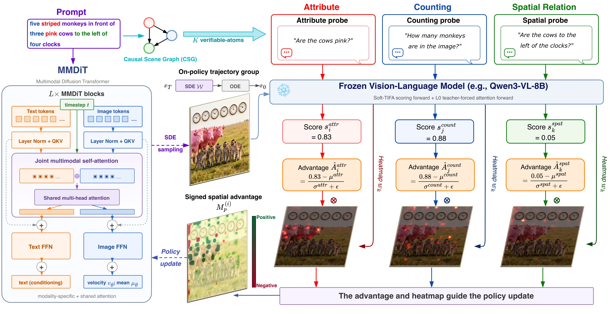
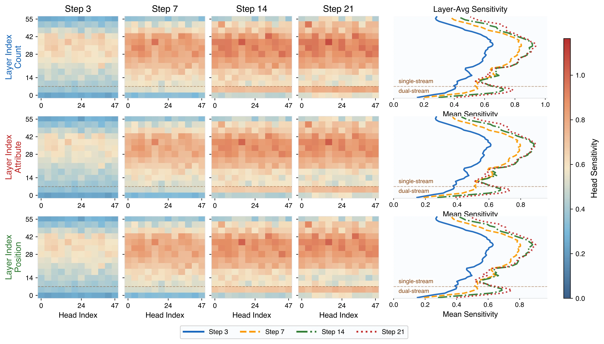
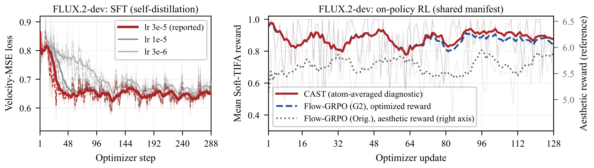

# CAST: Causal Advantage-Structured Training with Spatially Grounded Compositional Rewards for Diffusion Models

<div align="center">

[[Website]](https://opencausalab.github.io/CAST)
[[ArXiv]](https://arxiv.org) *(coming soon)*

[](https://github.com/OpenCausaLab/CAST)

______________________________________________________________________

</div>

We introduce **CAST** (**C**ausal **A**dvantage-**S**tructured **T**raining), an RL fine-tuning method for pretrained diffusion models that (1) sets the SDE sampling window from each model's structure-formation point in the denoising trajectory, (2) decomposes prompts via Causal Scene Graphs into *verifiable-atoms* that are rewarded independently, and (3) projects signed atom-level advantages into pixel space to spatially weight the policy objective.

On the strongest open-source diffusion models (FLUX.2-dev, Qwen-Image-2512), CAST's improvement on the most challenging GenEval 2 prompts is up to **3.07×** that of Flow-GRPO within almost the same training budget, while overall generation quality also improves.

Our project page is at [https://opencausalab.github.io/CAST](https://opencausalab.github.io/CAST).

## Visual Results

<div align="center">
  
</div>

<p align="center"><em><b>Additional qualitative comparisons on FLUX.2-dev (part I).</b> GenEval 2 prompts with multi-object counts, attributes, and chained spatial relations. GenEval 2 score reported below each image.</em></p>

<div align="center">
  
</div>

<p align="center"><em>Additional qualitative comparisons on FLUX.2-dev (part II). GenEval 2 score reported below each image.</em></p>

<div align="center">
  
</div>

<p align="center"><em><b>Compositional failures in baselines and CAST's improvement.</b> GenEval 2 prompts: (a) "five striped monkeys in front of three pink cows to the left of four clocks." (b) "a plastic horse under a glass raccoon." GenEval 2 score reported below each image. Only CAST satisfies all verifiable-atoms in both prompts.</em></p>

## Motivation

<div align="center">
  
</div>

<p align="center"><em><b>Image structure forms in early denoising steps.</b> Left: intermediate decoded images at five timesteps for three diffusion models. Dashed borders mark the knee point where CLIP similarity plateaus. Right: CLIP-ViT-L/14 similarity between Tweedie estimates and the text prompt. The knee point (triangle) occurs before τ = 0.25 across all models, indicating that the main layout and composition are established early, so the SDE exploration window should be set from each model's own trajectory.</em></p>

<div align="center">
  
</div>

<p align="center"><em><b>Preference scores saturate and weakly track structured correctness.</b> (a) Score distributions pooled across the four DMs: PickScore concentrates near its ceiling, whereas GenEval 2 retains a broad dynamic range. (b) The contrast persists within every model's generations. (c) Preference agreement between PickScore and GenEval 2 is only slightly above the 50% random baseline (dashed line).</em></p>

## Method

<div align="center">
  
</div>

<p align="center"><em><b>Overview of CAST.</b> A Causal Scene Graph (CSG) decomposes the prompt into <em>K</em> verifiable-atoms. Three representative types of facts are shown: attributes (red), counts (blue), and spatial relations (green). A frozen VLM uses separate passes to score each atom and extract its teacher-forced attention map. The resulting atom advantages and maps are combined into a signed spatial map that weights the SDE policy objective.</em></p>

## Main Results

Within the same 2,048-image and 128-update budget and under the same reward signal, the Hard Case gain of CAST over the base model is **1.93×** that of scalar-reward Flow-GRPO on FLUX.2-dev and **3.07×** on Qwen-Image-2512. CAST also surpasses the high-selectivity distillation upper bound SFT (3/64) on both backbones, whose Hard Case gain amounts to only 37% and 58% of CAST's despite its 32× larger image budget, while attaining the highest Qwen-Image-Bench Overall on both backbones.

**Final held-out performance on GenEval 2 and Qwen-Image-Bench.** G2 Hard-50 is the GenEval 2 Overall score on the 50-prompt Hard Case subset of unsaturated evaluation prompts. Values are mean ± sample standard deviation over four matched generation-seed replicates.

| Backbone | Method | G2 Hard-50 ↑ | G2 Overall ↑ | G2 Count ↑ | G2 Position ↑ | QIB Overall ↑ |
|:---------|:-------|-------------:|-------------:|-----------:|--------------:|--------------:|
| FLUX.2-dev | Base | 65.72 ± 1.83 | 83.16 ± 0.20 | 66.15 ± 0.60 | 73.29 ± 0.42 | 52.84 ± 0.27 |
| | SFT (4/8) | 67.28 ± 2.06 | 83.31 ± 0.24 | 66.37 ± 0.60 | 73.46 ± 0.51 | 52.76 ± 0.25 |
| | SFT (3/64) | 69.76 ± 2.48 | 83.93 ± 0.40 | 67.27 ± 0.60 | 74.15 ± 0.88 | 52.42 ± 0.16 |
| | Flow-GRPO (Orig.) | 64.26 ± 1.76 | 81.85 ± 0.22 | 64.18 ± 0.44 | 72.71 ± 1.13 | 53.34 ± 0.28 |
| | Flow-GRPO (G2) | 71.37 ± 1.90 | 84.54 ± 0.11 | 68.39 ± 0.32 | 74.98 ± 0.62 | 52.73 ± 0.06 |
| | **CAST** | **76.64 ± 2.39** | **85.95 ± 0.10** | **70.85 ± 0.29** | **76.90 ± 0.53** | **53.44 ± 0.29** |
| Qwen-Image-2512 | Base | 67.79 ± 1.81 | 78.02 ± 0.56 | 67.14 ± 1.59 | 59.60 ± 0.84 | 50.68 ± 0.23 |
| | SFT (4/8) | 68.55 ± 1.79 | 78.27 ± 0.54 | 67.64 ± 1.55 | 59.62 ± 0.78 | 50.45 ± 0.24 |
| | SFT (3/64) | 70.12 ± 1.84 | 79.29 ± 0.45 | 69.64 ± 1.37 | 59.72 ± 0.53 | 49.55 ± 0.29 |
| | Flow-GRPO (Orig.) | 68.60 ± 1.75 | 77.90 ± 0.44 | 67.15 ± 1.07 | 59.92 ± 0.91 | 50.11 ± 0.26 |
| | Flow-GRPO (G2) | 69.11 ± 1.56 | 79.59 ± 0.22 | 70.48 ± 0.62 | 58.59 ± 0.25 | 50.70 ± 0.15 |
| | **CAST** | **71.84 ± 1.85** | **80.81 ± 0.23** | **72.35 ± 0.55** | **60.45 ± 0.43** | **51.32 ± 0.15** |

**Raw training cost within each backbone.** All generated and scored candidates, including filtered or discarded candidates, are counted.

| Method | Images ↓ | Updates ↓ | FLUX H200-h ↓ | Qwen H200-h ↓ |
|:-------|---------:|----------:|--------------:|--------------:|
| SFT (4/8) | 8,192 | 384 | 95.00 | 90.24 |
| SFT (3/64) | 65,536 | 288 | 749.51 | 723.70 |
| Flow-GRPO (Orig.) | 2,048 | 128 | 28.91 | 28.75 |
| Flow-GRPO (G2) | 2,048 | 128 | 32.43 | 32.21 |
| **CAST** | 2,048 | 128 | 32.90 | 32.51 |

## Ablation

Ablation of atom-level credit assignment and spatial weighting on FLUX.2-dev. All variants use the same training prompts, SDE window, generated-image budget, and optimization settings. Values are mean ± sample standard deviation over four matched generation-seed replicates.

| Variant | Advantage | Spatial map | G2 Overall ↑ | QIB Overall ↑ |
|:--------|:----------|:------------|-------------:|--------------:|
| Sum-reward baseline | per-image | none | 84.54 ± 0.11 | 52.73 ± 0.06 |
| Per-atom advantage | per-atom | none | 85.12 ± 0.14 | 52.98 ± 0.18 |
| Spatial weighting | per-image | aggregated attention | 84.91 ± 0.16 | 53.06 ± 0.20 |
| Shuffled correspondence | per-atom | shuffled atom maps | 85.00 ± 0.15 | 52.89 ± 0.22 |
| **CAST** | **per-atom** | **matched atom maps** | **85.95 ± 0.10** | **53.44 ± 0.29** |

## Attention-Head Dynamics

<div align="center">
  
</div>

<p align="center"><em><b>Attention-head sensitivity across denoising steps.</b> Each heatmap cell averages a 4×4 group of transformer layers and attention heads. The side panels show the layer-wise mean sensitivity at each step, and the dashed line separates the dual-stream layers (0–7) from the single-stream layers (8–55). Spatial relation is most sensitive at the early step and then declines; attribute becomes broadly sensitive from step 7 onward; count is most clearly separated at step 7. The most sensitive heads overlap substantially across the three aspects (count, attribute, and spatial relation), indicating temporal differences rather than a one-to-one assignment between aspects and attention heads.</em></p>

## Training Dynamics

<div align="center">
  
</div>

<p align="center"><em><b>Training dynamics on FLUX.2-dev.</b> Left: SFT self-distillation loss under three learning rates; the reported setting is emphasized, and all runs plateau within the budget. Right: mean Soft-TIFA reward on the shared RL manifest; the CAST curve is an atom-averaged diagnostic rather than its optimized objective, and the aesthetic reward (right axis) is on a separate scale.</em></p>

## Citation

If you find our work useful in your research, please cite:

```bibtex
@article{yu2026cast,
  title={CAST: Causal Advantage-Structured Training with Spatially Grounded Compositional Rewards for Diffusion Models},
  author={Shu Yu and Chaochao Lu},
  year={2026},
  journal={arXiv preprint arXiv:XXXX.XXXXX}
}
```

## License

This project is released under the [Apache 2.0 License](LICENSE).
